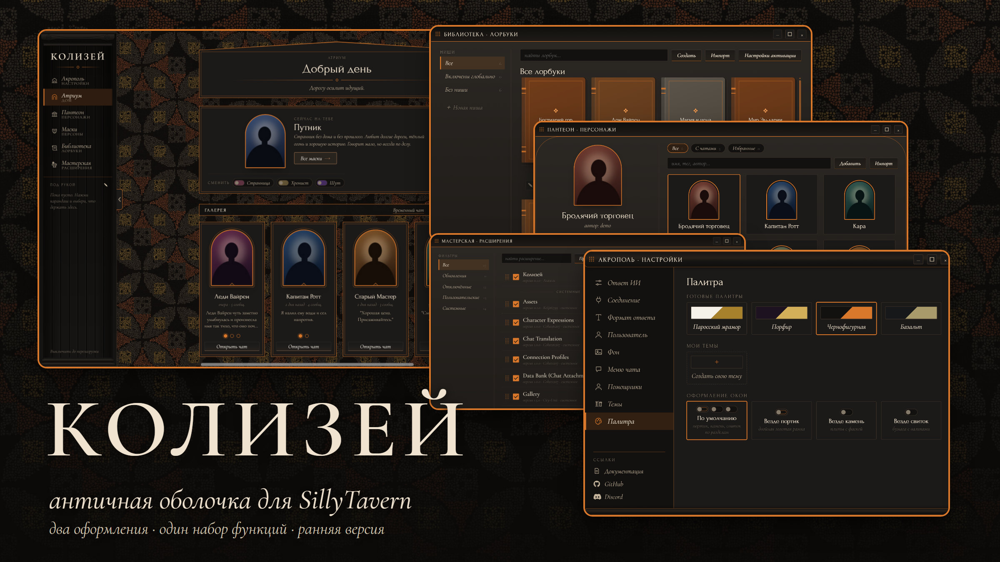
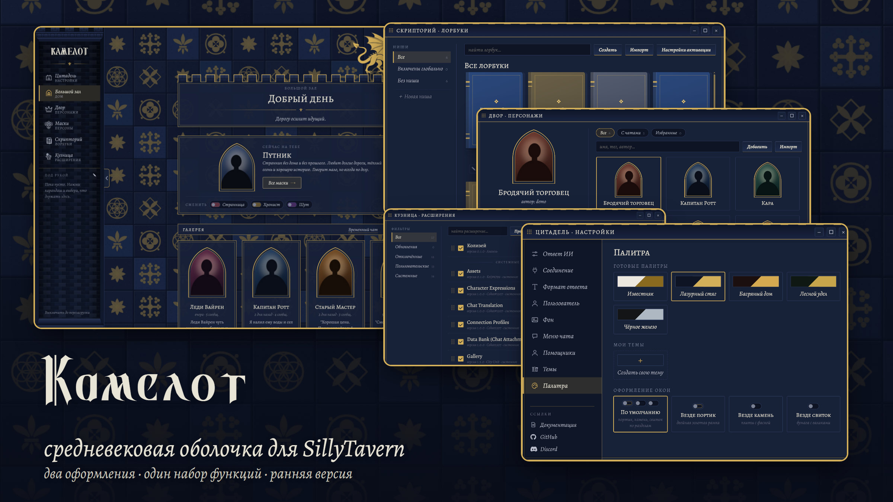
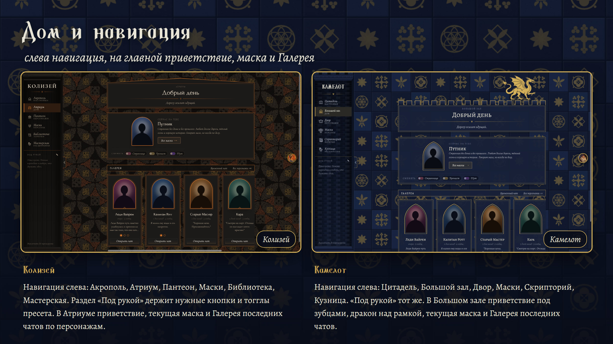
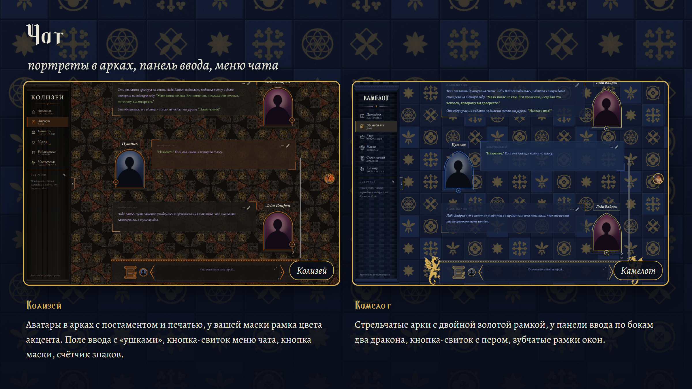
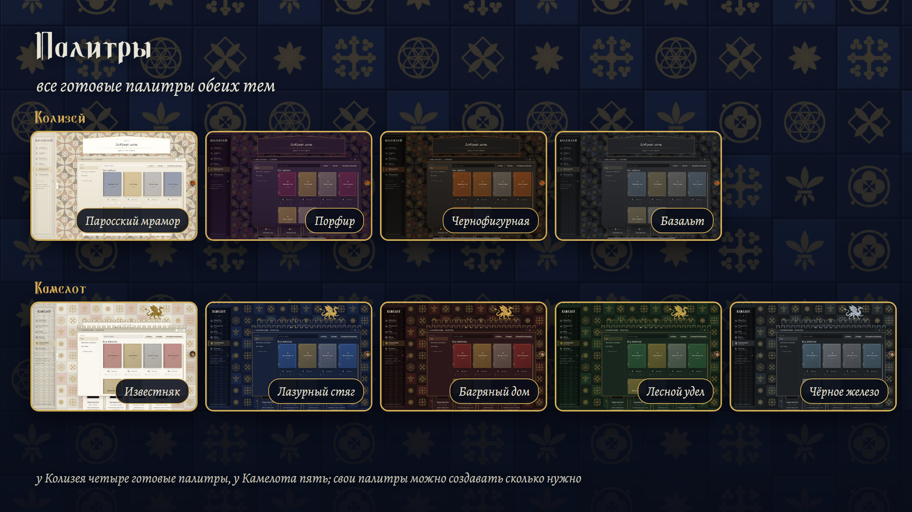
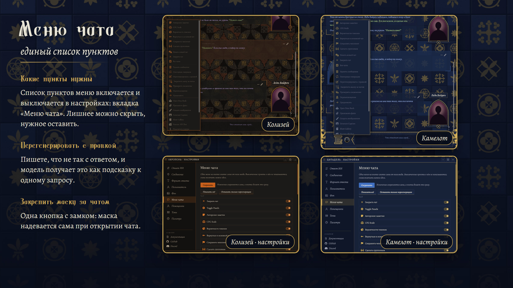
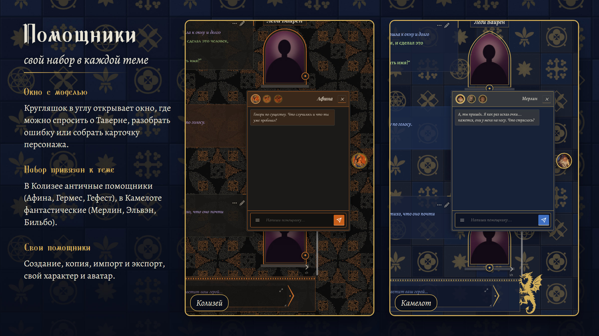
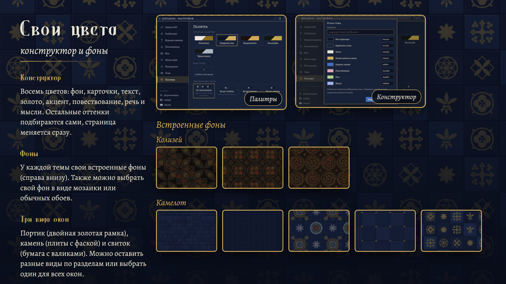

# Колизей и Камелот

One SillyTavern extension with two full visual styles: ancient Coliseum and medieval Camelot. Russian interface.

Расширение для SillyTavern с двумя полными оформлениями и общим набором функций. **Колизей**: мозаики, колонна и античные свитки. **Камелот**: крепость, башня, стрельчатые арки и драконы. Это не два разных расширения: переключатель стоит во вкладке «Темы» в настройках.

## Чем отличается от обычного оформления Таверны

Это не просто смена цветов. Расширение перестраивает интерфейс, а все данные и функции Таверны остаются её собственными.

| Обычная Таверна | Колизей и Камелот |
|---|---|
| Верхняя панель с иконками, выдвижные панели поверх чата | Навигация слева (колонна в Колизее, башня в Камелоте), родная верхняя панель скрыта |
| Настройки, персонажи, персоны, лорбуки и расширения открываются как панели | Всё открывается плавающими окнами: перетаскиваются, меняют размер за уголок, сворачиваются, запоминают место |
| Окна не связаны между собой | Свиток лорбука и редактор промпта пресета открываются склеенными сбоку, ручка на шве раскрывает любую сторону |
| Список чатов и персонажей отдельно | Главная страница: приветствие, текущая маска, быстрая смена и Галерея последних чатов по персонажам |
| Две отдельные кнопки меню в строке ввода | Одно меню чата с крупной кнопкой-свитком, пункты можно скрывать |
| Тема это набор цветов | Тема это целое оформление: каркас, фоны, арки, шрифты, значки, свой набор помощников, плюс палитры и конструктор цветов |

Что остаётся родным: поля настроек ИИ, соединения, формата ответа и пользователя переезжают внутрь окна настроек целиком, редактор карточки персонажа тоже родной. Сохранение, события и действия Таверны работают как раньше, а расширения, которые вешаются на её кнопки, продолжают работать.

## Обзор

Колизей и Камелот рядом.

### Дом и навигация

### Чат

### Палитры

У Колизея четыре готовые палитры, у Камелота пять, светлые и тёмные.

## Особенности

### Меню чата

Крупная кнопка-свиток открывает единый список пунктов Таверны и расширений. Какие пункты показывать, включается и выключается в настройках, вкладка «Меню чата». Два своих пункта:

- **Перегенерировать с правкой**: вы пишете, что не так с ответом, и модель получает это как подсказку к одному запросу. В историю чата подсказка не попадает.
- **Закрепить маску за чатом**: одна кнопка с замком, маска надевается сама при открытии чата.

### Помощники

Кругляшок в углу открывает окно с моделью: вопросы о Таверне, разбор ошибок, помощь с карточками. Набор готовых помощников привязан к теме: в Колизее античные (Афина, Гермес, Гефест), в Камелоте фантастические (Мерлин, Эльвэн, Бильбо). Свои помощники общие для обеих тем.

### Свои цвета

Конструктор из восьми цветов, остальные оттенки подбираются сами. У каждой темы свои встроенные фоны (три у Колизея, пять у Камелота: мозаики, кладка, плиты). Также можно выбрать свой фон в виде мозаики или обычных обоев. Три вида окон на выбор: портик (двойная золотая рамка), камень (плиты с фаской) и свиток (бумага с валиками), по разделам или один для всех. Фоны показаны внизу слайда.

## Возможности

- **Окна.** Акрополь или Цитадель (настройки), Пантеон или Двор (персонажи), Маски, Библиотека или Скрипторий (лорбуки), Мастерская или Кузница (расширения). Размер и положение запоминаются, окно можно развернуть на весь экран.
- **Склеенные окна.** Свиток лорбука рядом с библиотекой и редактор промптов рядом с настройками, граница между ними двигается.
- **Лорбуки.** Библиотека с нишами, Свиток записей (режимы срабатывания, позиции, фильтр персонажей, перенос записей), связи книги, «Лорбуки чата» и «Что сработало из лорбуков».
- **Маски.** Анкета или обычное описание, лорбук маски, привязка к персонажам и чатам, смена маски на главной и в строке ввода.
- **Мастерская расширений.** Порядок, закрепление, включение и выключение, обновления, настройки расширения рядом.
- **Под рукой.** Тогглы пресета и кнопки расширений, вынесенные в колонну.
- **Меню чата.** Единый список, свои пункты: «Перегенерировать с правкой», «Закрепить маску за чатом», «Проверить соединение»; любой пункт можно скрыть.
- **Помощники.** Окно с моделью, свой набор у каждой темы, свои помощники.
- **Палитры, фоны и окна.** Готовые палитры, конструктор из восьми цветов, встроенные и свои фоны, три вида окон.
- **Хранилище настроек** с защитой от конфликтов между вкладками браузера.

## Установка

В SillyTavern откройте **Extensions → Install extension** и вставьте:

`https://github.com/mercazazel-sudo/SillyTavern-Coliseum`

Минимальная версия SillyTavern по манифесту `1.19.0`. После установки обновите страницу. Выбрать оформление: настройки (иконка слева вверху) → вкладка «Темы». Обновления приходят кнопкой Update в менеджере расширений.

**Статус:** ранняя версия `0.2.0`. Картинки выше сняты с настоящего расширения в чистой Таверне на выдуманных данных. Не проверены полностью: чистая установка на другой машине, узкие экраны, английская локаль, сценарии с несколькими вкладками. Перед использованием с важными данными сделайте резервную копию SillyTavern.

**Совместимость:** вместе с Пудреницей не работает, отключите одно из двух. Код и ассеты Пудреницы здесь не используются.

## Лицензии

Код: MIT, см. [LICENSE](LICENSE). Сведения о графике и шрифтах: [ASSETS-NOTICE.md](ASSETS-NOTICE.md); лицензии открытых шрифтов лежат в `assets/fonts/licenses/`.
